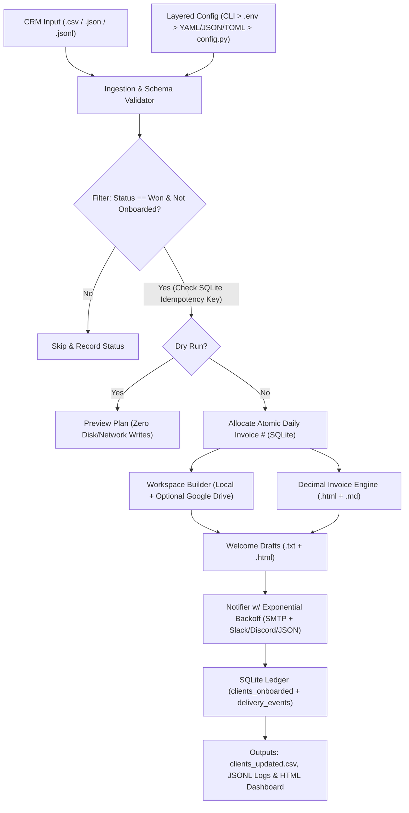

# Client Onboarding Bot

> **Production-grade, idempotent client onboarding automation engine** — transforms newly won CRM deals (CSV, JSON, JSONL) into structured client workspaces, milestone trackers, print-ready `Decimal` invoices, personalized multipart welcome emails, team alerts, and executive HTML reports.

[](pyproject.toml)
[-brightgreen.svg)](pyproject.toml)
[](src/client_onboarding_bot/state_store.py)
[](.github/workflows/ci.yml)

---

## Overview

Manual client onboarding introduces inconsistent folder layouts, billing calculation mistakes, duplicate invoices, and delayed kickoffs. **Client Onboarding Bot** replaces manual checklists with a deterministic, fault-tolerant workflow pipeline:

1. **Ingests & Validates** CRM records from `.csv`, `.json`, or `.jsonl` exports with row-level error isolation.
2. **Enforces Idempotency** using an embedded SQLite WAL ledger (`onboarding.db`) and atomic daily invoice sequence counters (`INV-YYYYMMDD-###`), preventing duplicate onboarding even across repeated runs against the same input file.
3. **Provisions Workspaces** locally or idempotently in **Google Drive**, generating `Project_Tracker.csv` and `Kickoff_Brief.md`.
4. **Generates Financial Invoices** using `decimal.Decimal` (`ROUND_HALF_UP`) math, multi-currency support, discounts, configurable tax/VAT rates, and XSS-escaped, print-ready HTML5 + Markdown drafts.
5. **Delivers Notifications** via plaintext/HTML welcome drafts, optional Gmail/generic SMTP (with invoice attachments), and Slack Block Kit, Discord Embed, or generic JSON webhooks with exponential backoff retries and a `retry-failed` recovery command.
6. **Produces Observability Artifacts**: structured JSONL run logs, updated CRM exports (`clients_updated.csv`/`.json`), `latest_run.json`, and an offline `onboarding_dashboard.html` ledger.

---

## Architecture



---

## Core Capabilities

| Capability | Implementation Details |
| :--- | :--- |
| **Zero-Dependency Core** | Runs out of the box on Python 3.10+ standard library (built-in `.env` parser, SQLite, `urllib`, `smtplib`, `csv`, `json`). Optional extras for YAML & Google Drive API. |
| **Idempotent State Store** | SQLite (`PRAGMA journal_mode=WAL`) keyed by external `Client ID` or normalized `(Client Name, Project Name, Email)`. Safe to run repeatedly on cron/CI. |
| **Atomic Invoice Sequencing** | Persists daily counters in `invoice_sequences` and auto-seeds from historical CRM invoice numbers to guarantee collision-free numbering. |
| **Exact Financial Math** | `Decimal` arithmetic (`ROUND_HALF_UP`) with percentage or flat discounts, per-client currency & tax/VAT overrides, and XSS-safe `@media print` HTML5 invoices. |
| **Per-Client Error Isolation** | Invalid rows or transient network/SMTP failures never abort healthy clients. Partial runs store failed channels in `delivery_events` for surgical replay via `retry-failed`. |
| **Layered Configuration** | Precedence: CLI Flags → Environment / `.env` → `config.yaml` / `.json` / `.toml` → `config.py` defaults. |
| **Dry-Run Previews** | `--dry-run` validates records, previews workspace slugs and invoice numbers, and performs zero disk, SQLite, or API mutations. |

---

## Quickstart

Run locally in under 30 seconds with **zero API keys or third-party installs**:

```bash
# 1. Pre-flight check on sample CRM data & config
python3 main.py validate --input sample_data/clients_sample.csv

# 2. Preview onboarding plan without writing files
python3 main.py --dry-run

# 3. Execute local onboarding
python3 main.py

# 4. Inspect persisted SQLite ledger & regenerate HTML executive dashboard
python3 main.py status
python3 main.py report
```

Generated artifacts appear under `output/`:
- `output/clients/Bright_Smile_Dental/` — Client subfolders, `Project_Tracker.csv`, `Kickoff_Brief.md`, `welcome_email_draft.txt`, `welcome_email_draft.html`
- `output/clients/Bright_Smile_Dental/01_Contracts_and_Invoices/INV-YYYYMMDD-001.html` (and `.md`)
- `output/clients_updated.csv` — Updated CRM export preserving all original columns
- `output/state/onboarding.db` — Persistent SQLite idempotency & delivery audit database
- `output/reports/onboarding_dashboard.html` & `latest_run.json` — Executive summary & telemetry
- `output/logs/onboarding_YYYYMMDD.jsonl` — Structured JSONL execution logs

Try the enterprise multi-currency JSON dataset (`EUR` + `SAR`, discounts, VAT, custom payment terms):

```bash
python3 main.py --input sample_data/clients_enterprise.json --config config.example.yaml
```

---

## CLI Reference

`python3 main.py` defaults to `onboard` when no subcommand is specified, preserving direct CLI usage while exposing operational subcommands:

| Command | Purpose |
| :--- | :--- |
| `onboard` *(default)* | Validate CRM records, create workspaces, generate invoices, draft/send emails & webhooks. |
| `validate` | Pre-flight schema check for CRM files and active integration credentials (`0` = valid). |
| `status` | Query `onboarding.db` (`--status completed\|partial\|failed`, `--json` for automation). |
| `retry-failed` | Replay failed `email_smtp` or `webhook` deliveries recorded in SQLite without re-invoicing. |
| `report` | Regenerate `output/reports/onboarding_dashboard.html` from SQLite state. |

### Key Options (`onboard`)

| Flag | Description |
| :--- | :--- |
| `--input`, `--input-csv PATH` | Path to `.csv`, `.json`, or `.jsonl` CRM file (default: `sample_data/clients_sample.csv`). |
| `--config PATH` | Load declarative `.yaml`, `.yml`, `.json`, or `.toml` settings file. |
| `--mode local\|gdrive` | Provision local folders or idempotent Google Drive folders (`gdrive`). |
| `--dry-run` | Simulate the full batch without writing files, mutating SQLite, or sending alerts. |
| `--send-emails` | Deliver multipart plain+HTML welcome emails via Gmail or custom SMTP. |
| `--attach-invoice` | Attach the generated HTML invoice when `--send-emails` is active. |
| `--notify-webhook` | Post native Slack Block Kit, Discord Embed, or generic JSON payload to `WEBHOOK_URL`. |
| `--client "NAME"` | Target a single client record by name. |
| `--force` | Re-onboard matching `Won` clients even if already present in SQLite. |
| `--in-place` | Also persist `Onboarded`, `Onboarded Date`, and `Invoice Number` back to `--input`. |
| `--json-logs` | Emit structured JSON log lines to stdout for log collectors. |
| `--output-dir PATH` | Override base output directory (default: `output/`). |
| `--db-path PATH` | Override SQLite database path (default: `output/state/onboarding.db`). |

---

## CRM Input Schema

Supports **CSV**, **JSON** (array or `{"clients": [...]}`), and **JSONL**. Arbitrary extra CRM columns are preserved on export.

| Column / Field | Required | Format / Example | Notes |
| :--- | :---: | :--- | :--- |
| `Client Name` | Yes | `Bright Smile Dental` | Used for billing and collision-safe workspace slugging. |
| `Status` | Yes | `Won`, `Prospect` | Only records with `Won` (case-insensitive) trigger onboarding. |
| `Contact Name` | No | `Dr. Sarah Lin` | Falls back to `Client Name` in greetings. |
| `Email` | No | `hello@example.com` | Syntax-validated; required if `--send-emails` is used. |
| `Project Name` | No | `AI Appointment Bot` | Defaults to `Automation Setup`. |
| `Project Fee` | No | `$750`, `SAR 7,500`, `2400.00` | Parsed via `Decimal` with inline currency detection. |
| `Currency` | No | `USD`, `EUR`, `GBP`, `SAR`, `AED` | Overrides agency default and inline symbols. |
| `Discount` | No | `10%` or `$50` | Percentage or flat fee deduction prior to tax. |
| `Tax Rate` | No | `15%` or `0.15` | Overrides global `tax_rate` for this client. |
| `Payment Terms Days` | No | `14`, `30` | Overrides default `invoice_due_days`. |
| `Start Date` | No | `2026-11-25` | ISO `YYYY-MM-DD`; defaults to execution date. |
| `Client ID` | No | `CRM-1042` | Preferred deterministic idempotency key when present. |
| `Tier` / `Notes` | No | `Enterprise` | Rendered into `Kickoff_Brief.md`. |
| `Onboarded` | No | `Yes` / `No` | Input guard combined with SQLite idempotency lookup. |

---

## Configuration & Integrations

Copy `.env.example` to `.env` (and optionally `config.example.yaml` to `config.yaml`).

### 1. Declarative Agency Config (`config.yaml` / `config.json` / `config.toml`)
Customize agency billing address, `tax_id`, `tax_label` (`Tax` / `VAT` / `GST`), `tax_rate`, `currency_code`, `subfolders`, `milestones`, and `retry` policy without editing Python code. See [config.example.yaml](config.example.yaml).

### 2. Google Drive API (`--mode gdrive`)
1. Install optional extras: `pip install -e ".[gdrive]"` (or `pip install -r requirements.txt`).
2. Place your Google Cloud Service Account JSON key at `GOOGLE_CREDENTIALS_PATH` and share your target parent folder with the service account email as **Editor**.
3. Set `GOOGLE_DRIVE_PARENT_FOLDER_ID` in `.env` and run `python3 main.py --mode gdrive`.
   - Folders are looked up by name before creation to avoid duplicates on re-runs.

### 3. Email Delivery (`--send-emails`)
- **Gmail SMTP:** Set `GMAIL_ADDRESS` and a 16-character `GMAIL_APP_PASSWORD` in `.env`.
- **Custom SMTP (SendGrid / Postmark / SES / Mailgun):** Set `SMTP_HOST`, `SMTP_PORT`, `SMTP_USERNAME`, `SMTP_PASSWORD`, `SMTP_USE_TLS`, and `SMTP_FROM`.

### 4. Team Webhooks (`--notify-webhook`)
Set `WEBHOOK_URL` in `.env`. With `WEBHOOK_FORMAT=auto`, the bot automatically emits:
- **Slack Block Kit** payloads for `hooks.slack.com`
- **Discord Rich Embeds** for `discord.com/api/webhooks`
- **Structured JSON event payloads** (`event: "client.onboarded"`) for custom endpoints / n8n / Zapier / Make.

---

## Project Structure

```text
client-onboarding-bot/
├── .github/workflows/ci.yml           # Automated CI (Ruff, mypy, pytest, unittest, CLI smoke)
├── config.py                          # Baseline Python configuration defaults
├── config.example.yaml                # Declarative agency & pipeline config template
├── main.py                            # Root CLI entrypoint
├── pyproject.toml                     # PEP 621 package metadata, CLI script, pytest/ruff/mypy config
├── requirements.txt                   # Optional integration dependencies
├── Dockerfile                         # Non-root production container image
├── Makefile                           # Common test, lint, run & report targets
├── sample_data/
│   ├── clients_sample.csv             # Standard CSV CRM dataset
│   └── clients_enterprise.json        # Multi-currency JSON dataset (discounts, VAT, Client ID)
├── src/client_onboarding_bot/
│   ├── __init__.py
│   ├── cli.py                         # Subcommand dispatcher & backward-compatible CLI
│   ├── config.py                      # Layered config & built-in .env loader + validator
│   ├── ingestion.py                   # Multi-format CRM loader, money/rate parser & exporter
│   ├── invoice_builder.py             # Decimal billing engine, Markdown & XSS-safe HTML5 invoices
│   ├── logging_utils.py               # Dual console + JSONL file logger
│   ├── models.py                      # Typed dataclasses & deterministic idempotency keys
│   ├── notifier.py                    # Multipart email, SMTP & webhook delivery with retries
│   ├── pipeline.py                    # Orchestrator with error isolation, dry-run & retry-failed
│   ├── reporting.py                   # JSON telemetry & offline HTML5 executive dashboard
│   ├── state_store.py                 # SQLite WAL ledger, invoice sequences & delivery tracking
│   └── workspace_builder.py           # Collision-safe local & Google Drive workspace provisioning
└── tests/
    ├── test_config.py
    ├── test_ingestion.py
    ├── test_invoice_builder.py
    ├── test_notifier.py
    ├── test_pipeline_e2e.py
    ├── test_state_store.py
    └── test_workspace_builder.py
```

---

## Testing, Quality & Docker

### Run Automated Tests
```bash
# Using pytest (recommended)
pytest -v

# Using standard library unittest (zero external packages)
python3 -m unittest discover -s tests -v
```

### Static Analysis (with `[dev]` extras installed)
```bash
pip install -e ".[yaml,dev]"
ruff check src tests
mypy src
```

### Container Execution
```bash
docker build -t client-onboarding-bot:latest .
docker run --rm -v "$(pwd)/output:/app/output" client-onboarding-bot:latest \
  onboard --input sample_data/clients_sample.csv
```

---

## Documentation

See **[LEARNING_GUIDE.md](LEARNING_GUIDE.md)** for a deep-dive architecture walkthrough, SQLite state model overview, and operational customization cookbook.
# client-onboarding-bot
